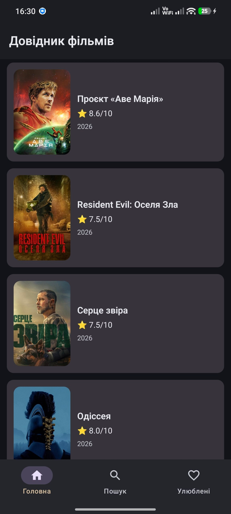
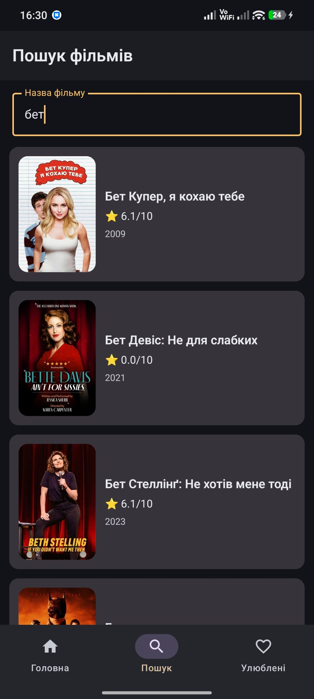
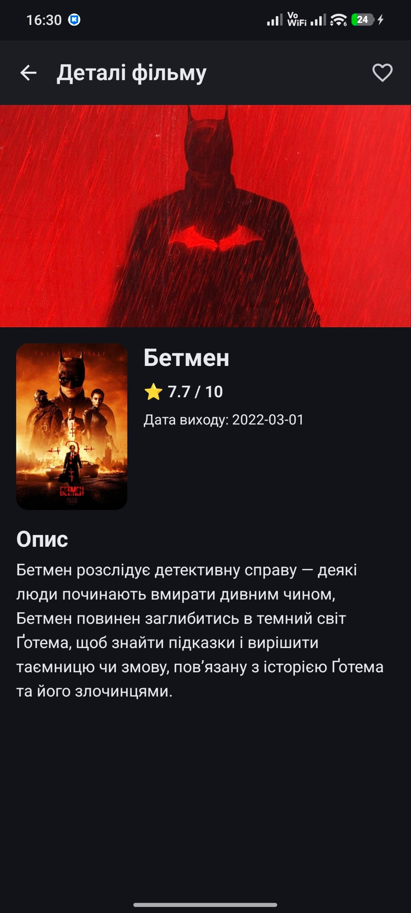
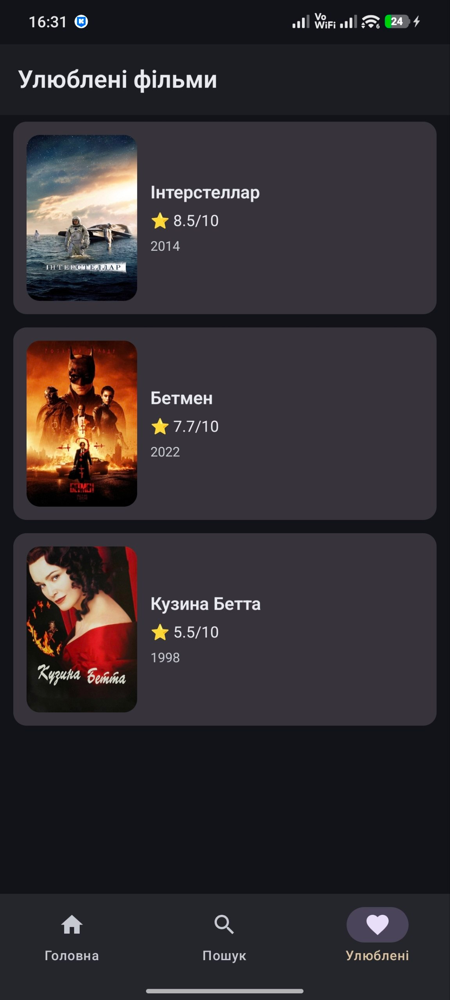

# Movie Explorer 🎬

**Movie Explorer** is an Android application for discovering movies, searching the TMDB catalog, viewing movie details, and managing a personal list of favorites.

Built as a Kotlin + Jetpack Compose portfolio project to practice **MVVM**, REST API integration, reactive UI state, navigation, and local persistence.

## ✨ Features

- **Popular movies:** browse a list of popular movies from TMDB.
- **Search:** find movies by title with a 500 ms debounce to avoid unnecessary requests.
- **Movie details:** view a movie's title, images, rating, release date, and overview.
- **Favorites:** add or remove movies from a locally persisted list using Room.
- **Offline favorites:** previously saved favorites remain available without an internet connection.
- **Reactive UI:** loading, success, empty, and error states powered by `StateFlow` and Jetpack Compose.
- **Error handling:** readable error messages and retry actions for supported network screens.
- **Modern UI:** Material 3, dark/light themes, poster placeholders, and bottom navigation.

## 📱 Screenshots


| Home | Search |
|:---:|:---:|
|  |  |

| Movie details | Favorites |
|:---:|:---:|
|  |  |

<!-- Optional: once you've recorded a real demo GIF, uncomment the following lines.
### Demo

-->

## 🏗️ Architecture

The application follows **MVVM** with separate UI, domain, and data layers. Dependencies are wired manually using `ViewModelProvider` / `viewModelFactory`; no dependency injection framework is required.

```text
UI layer
Jetpack Compose screens + ViewModels + UiState
                      |
                      v
Domain layer
Movie / MovieDetails + MovieRepository interface
                      ^
                      |
Data layer
MovieRepositoryImpl + DTO / Entity mappers
                /                 \
               v                   v
       Retrofit + TMDB API       Room DAO
```

- **UI:** displays state and forwards user actions to ViewModels.
- **ViewModels:** manage `StateFlow` state, asynchronous operations, and user events.
- **Domain:** defines movie models and the `MovieRepository` contract.
- **Data:** implements the repository, maps remote/local models, and accesses TMDB and Room.

## 🛠️ Tech Stack

| Technology | Purpose |
|---|---|
| Kotlin | Application language |
| Jetpack Compose + Material 3 | Declarative UI and theming |
| MVVM | Presentation architecture |
| Retrofit + REST API | Remote movie data |
| Kotlinx Serialization | JSON parsing |
| Kotlin Coroutines | Asynchronous work |
| Flow / StateFlow | Reactive state and database updates |
| Room | Persistent local favorites |
| Navigation Compose | Screen navigation with movie IDs |
| Coil 3 | Poster and backdrop loading |
| JUnit + Kotlinx Coroutines Test | Unit testing |
| AndroidX Test + Room in-memory database | Instrumented tests |

## 🌐 API

Movie information is provided by **[The Movie Database (TMDB)](https://www.themoviedb.org/)** using the TMDB v3 API.

| Endpoint | Usage |
|---|---|
| `GET /movie/popular` | Popular movie list |
| `GET /search/movie` | Search by title |
| `GET /movie/{movieId}` | Details of a selected movie |

- API base URL: `https://api.themoviedb.org/3/`
- Request language: `uk-UA`
- Authentication: API Read Access Token in the `Authorization: Bearer ...` header

**TMDB attribution:** This product uses the TMDB API but is not endorsed or certified by TMDB.

See the [TMDB API documentation](https://developer.themoviedb.org/docs/getting-started) and [attribution requirements](https://developer.themoviedb.org/docs/faq).

## 🚀 Getting Started

1. Clone the repository:

   ```bash
   git clone https://github.com/maksympash-code/MovieExplorer.git
   ```

2. Open the project in **Android Studio**.
3. Get a **TMDB API Read Access Token** from your TMDB account's API settings.
4. In the **project root** `local.properties`, add:

   ```properties
   TMDB_ACCESS_TOKEN=your_tmdb_api_read_access_token
   ```

5. Sync Gradle, then run the `app` configuration on an Android device or emulator (minimum Android API level **24**).

> `local.properties` is ignored by Git. Never commit your real token. For production distribution, note that a token compiled into `BuildConfig` can still be extracted from an APK; keeping it out of Git is not equivalent to keeping it secret from app users.

## 🧪 Testing

**Local unit tests** cover search behavior (including debounce and cancellation) and the popular-movies ViewModel (loading, success, and retry after error).

```bash
./gradlew testDebugUnitTest
```

**Instrumented tests** exercise Room favorites and TMDB API integration. Run them with a connected Android device or emulator:

```bash
./gradlew connectedDebugAndroidTest
```

TMDB API integration tests require an internet connection and a valid access token.

Manual QA covers searching, opening details, adding/removing favorites, persistence after restarting the app, and recovery after a network error.

## 📁 Project Structure

```text
app/src/main/java/ua/knu/maksym_pashchenko/movieexplorer/
├── MainActivity.kt
├── data/
│   ├── local/                # Room database, DAO, entity
│   ├── mapper/               # DTO/entity ↔ domain mapping
│   ├── remote/               # Retrofit API, DTOs
│   └── repositoryImpl/       # MovieRepositoryImpl
├── domain/
│   ├── mapper/               # Domain model transformations
│   ├── model/                # Movie, MovieDetails
│   └── repository/           # MovieRepository interface
└── ui/
    ├── common/               # Loading, Empty, Error components
    ├── navigation/           # Routes, NavHost, bottom bar
    ├── screen/
    │   ├── common/           # MovieCard, MovieListContent
    │   ├── home/
    │   ├── search/
    │   ├── details/
    │   ├── favorites/
    │   └── viewmodel/
    └── theme/                # Colors, typography, spacing

app/src/test/               # Unit tests
app/src/androidTest/        # Instrumented tests
screenshots/                # Screenshots added for the README
```

## 📌 Project Status

Built and manually tested as a **30-day Android learning / portfolio project**.

---

Movie data and images are provided by [TMDB](https://www.themoviedb.org/).
